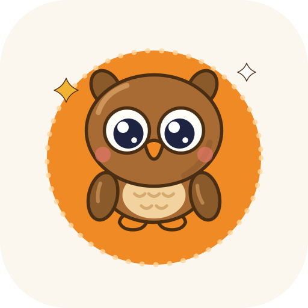
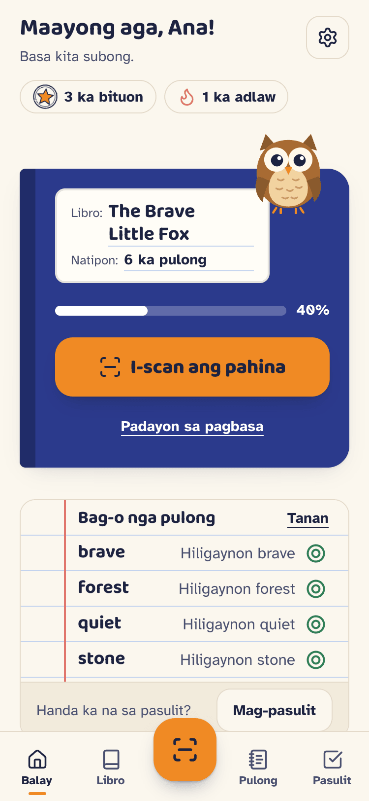
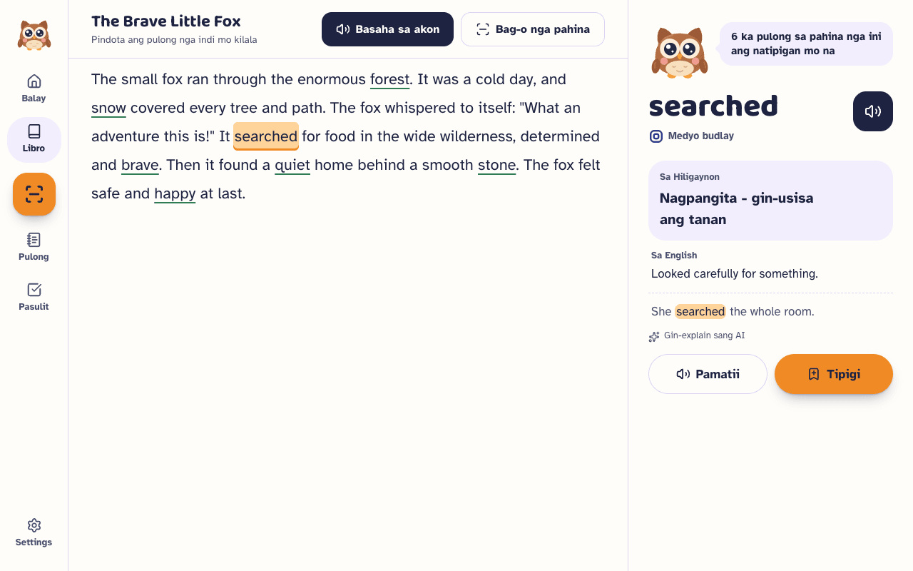

<div align="center">



# Handog Aral 🦉📖

**"Ang Imo Gabay sa Pagbasa"**

An offline-capable reading companion for Filipino children aged 6–12, including children with dyslexia.

[](https://handog-aral.vercel.app)


 &nbsp; 

</div>

---

A child points the camera at a printed English page (or opens a built-in story), taps any word they don't know, and gets an explanation in their own language — Hiligaynon or Filipino/Tagalog — with pronunciation, an example, and a difficulty marker. Saved words feed a short quiz, a daily streak and a sticker book.

It is a mobile-first PWA with a real desktop layout (side rail and a two-pane reader), wrapped for Android with Capacitor.

---

## ✨ Features

- 📷 **Scan or open a page.** Camera, gallery or typed text; six bundled stories.
- 👆 **Tap a word, get it in your language.** The home-language explanation comes first, then the English meaning and an example, with a Listen button.
- 📴 **Works without internet.** Scanning falls back to on-device OCR (Tesseract, self-hosted), words fall back to a curated dictionary, and anything looked up offline is upgraded automatically when the connection returns — the screen says honestly which kind of explanation you are seeing.
- ♿ **Built for dyslexia and small hands.** OpenDyslexic option, font-size scaling, reading colour overlays, speech speed, plain reading text straight on a near-white ground (no textured backgrounds behind words), line height tied to the font size, large touch targets, difficulty shown by shape and label (never colour alone), light and dark themes, reduced-motion support.
- 🎉 **Fun and cute, for young readers.** A chubby owl companion (flat SVG first, a lazy three.js version on capable devices) that reacts and wears outfits, 14 collectible stickers, a "Pares" memory game with saved words, and gentle celebrations. Sounds and haptics are optional; reduced motion turns off 3D and confetti.
- 🔒 **Private by design.** No accounts. Progress stays on the device; the AI key lives on the server, never in the app.

---

## 🎨 Design

The look is the **Sticker Sheet**: an open layout on a near-white ground, a pale lilac band behind each screen title carrying a little confetti, tinted pills instead of bordered cards, dotted-rule lists, and wavy-underlined section titles. Real card shapes are kept for physical things only (the notebook book cover, the memory-game cards). Orange is the one primary action color. The owl follows the reference sheet in `public/mascot/owl-expression-sheet.png`. Headings use Baloo 2, body text Atkinson Hyperlegible, with an OpenDyslexic option.

The rules and tokens live in [`DESIGN.md`](DESIGN.md) (the source of truth is `src/app/globals.css`). Regenerate icons with `node scripts/gen-pwa-icons.mjs` and `node scripts/gen-android-icons.mjs`, social cards with `node scripts/gen-og.mjs`.

---

## 🧰 Tech stack

Next.js 16 (App Router) · React 19 · TypeScript · Tailwind CSS v4 · shadcn/ui · lucide-react · GSAP · Dexie + zustand (IndexedDB) · Serwist (service worker) · Tesseract.js · Google Gemini via a server proxy (`@google/genai`, Upstash rate limiting) · Capacitor 8 · Vitest + Playwright

---

## 🚀 Getting started

Requires Node 20+ and npm.

```bash
npm install     # also copies the self-hosted Tesseract assets into public/tesseract/ (needs network once)
npm run dev     # http://localhost:3000
```

Without any keys the app still works: curated words, the online dictionary, and on-device OCR. To enable AI explanations and AI page reading locally, copy `.env.example` to `.env.local` and set `GEMINI_API_KEY`.

### Scripts

| Command | What it does |
|---|---|
| `npm run dev` | Development server (`/design` shows the design system, dev only) |
| `npm run build` / `npm start` | Production web build / serve it |
| `npm run build:android` | Static export for Capacitor, then `cap sync android` |
| `npm run typecheck` · `npm run lint` | Type check · ESLint |
| `npm test` | Unit and component tests (Vitest) |
| `npm run e2e` | End-to-end tests (Playwright, phone and desktop sizes) |

### Environment variables

| Variable | Where | Purpose |
|---|---|---|
| `GEMINI_API_KEY` | server | Word explanations and AI page reading |
| `GEMINI_MODEL` | server, optional | Defaults to `gemini-flash-latest` |
| `UPSTASH_REDIS_REST_URL`, `UPSTASH_REDIS_REST_TOKEN` | server | Per-IP rate limiting. Required in production: without them the proxy returns 503 |
| `ALLOWED_ORIGINS` | server, optional | Extra CORS origins (`https://localhost` and `capacitor://localhost` are always allowed) |
| `NEXT_PUBLIC_SITE_URL` | build | Production origin, used for the social-card image URLs (default `http://localhost:3000`) |
| `NEXT_PUBLIC_API_BASE` | build | Empty for the web build; the deployed URL for the Android build |

## ☁️ Deploying

**Web (Vercel):** import the repo, set the server variables above, deploy. The AI proxy runs as Next.js route handlers (`/api/explain`, `/api/ocr`, `/api/health`) in the same project. The web build sends security headers (`next.config.ts`: nosniff, frame-ancestors none, Permissions-Policy, a conservative CSP) and serves `/serwist/sw.js` uncached. Going live: follow [`docs/release-checklist.md`](docs/release-checklist.md).

**Android:** set `NEXT_PUBLIC_API_BASE` to the deployed web URL, run `npm run build:android`, then `npx cap open android` and build from Android Studio. The Android build is a static export (no service worker) that calls the deployed proxy.

## 🗂️ Project layout

```
src/app/         routes (thin server pages), API route handlers, manifest, service worker
src/features/    one folder per screen: home, welcome, books, reader, vocabulary, quiz, play, stickers, settings
src/components/  app shell, word panel, camera, owl/ (mascot and 3D model), art/ (authored SVG), celebration/; ui/ is shadcn
src/lib/         ocr/, tts/, dictionary/, queue/, motion, api client, quiz and vocabulary logic
src/stores/      IndexedDB (Dexie) and persisted zustand stores
src/server/      Gemini, rate limiting and CORS for the proxy (server only)
src/shared/      zod schemas shared by client and server
src/data/        bundled books, curated words, per-feature strings (Hiligaynon / Tagalog)
e2e/             Playwright specs
public/mascot/   the owl reference sheet the mascot is drawn from
docs/v3-plan.md  the v3 overhaul plan and status
CHANGELOG.md     version history
```

More detail for contributors (and AI assistants) is in [`CLAUDE.md`](CLAUDE.md); the product record is in [`PRODUCT.md`](PRODUCT.md) and the design system in [`DESIGN.md`](DESIGN.md).

---

## 🚧 Status and known gaps

- The offline dictionary currently holds the ~280 curated entries; a ~2,000-word generated dictionary is planned and needs a native-speaker review before its translations are treated as verified.
- Hiligaynon and Tagalog explanations produced by AI are not human-reviewed, and the owl's lines, sticker names and "Pares" copy are waiting on a native-speaker review (marked `// REVIEW: native speaker` in `src/data/strings/`).
- The AI proxy has not been exercised with a real Gemini key yet, and the Android build has not been tested on a physical device.
- Performance on very low-end phones is the main open item; the 3D owl turns itself off on slow connections, save-data, low-end devices and reduced motion.

## 📄 License

No license has been chosen yet.
